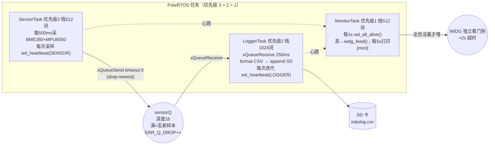
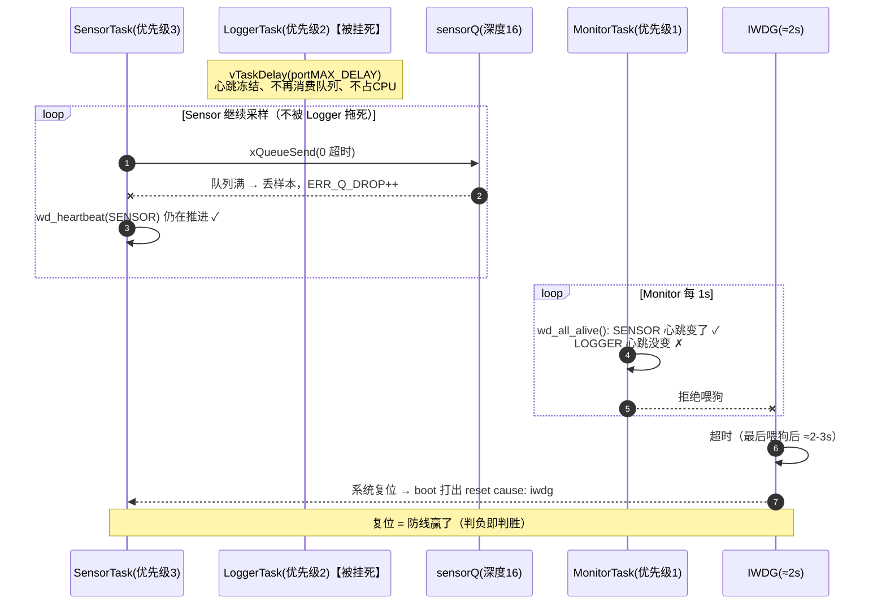

# T9 三任务流水线 + alive-mask 看门狗实验报告（Step 1–5）

> **为什么测 / 怎么测 / 测出了什么 / 怎么复刻** —— 自含上下文：先讲清每个实验打的工程主张与原理，给出手法与逐行预期，再给板上实测；按本文件可在同一块板上复刻全部实验。
>
> - **日期**：2026-11-16｜**分支**：`m1-skeleton`（04a7598 + 工作区 T9 代码，Step 7 未提交）｜**板**：Nucleo-F411RE（100 MHz，console=ST-LINK VCP 115200）
> - **固件**：T9 构建增量（80884 text / 35776 bss），板测阶段已在板上验证；boot 横幅时间戳因增量构建陈旧（踩坑 16），固件身份以构建尺寸 + CubeProgrammer `-u` 读回 `cmp` 为准
> - **证据**：`/mnt/c/temp/serial_cap.txt` 每轮捕获（易失，数值已固化进本文件）；主机测试 `host/build` ctest 7/7
> - **阅读前提**：与功能测试不同，Step 5 是**故障注入**——注入后"板子死得对"（确定性 IWDG 复位）= 实验 PASS。判负即判胜的逻辑同样适用：看到 `reset cause: iwdg` 不是故障，是被测防线赢了。

---

## 一、为什么测：从设计 spec 三主张倒推

InduLogger 的作品集定位建立在三个**可测量**的工程主张上（spec `docs/specs/2026-10-27-indulogger-design.md`）：**real-time（采样不被存储拖死）／reliability（任何单点挂死系统都能救回）／observability（健康状态可观测）**。

T6-T8 已经证明单任务形态下这三点的雏形（I2C 100ms 限界容错、传感器合理性检查、SD 拔卡自恢复）。但单任务架构有一个**结构性盲区**：

| 问题 | 单任务形态的答案 | 为什么不够 |
|---|---|---|
| 采样被 SD 卡拖慢怎么办？ | 没有——采样和落盘在同一循环 | 卡慢 = 采样慢，real-time 主张失守 |
| 任何任务挂死怎么办？ | default 任务喂 IWDG——**它喂的是自己** | 喂狗任务自己挂死 = 无人喂狗（碰巧也能复位，但那是"巧合活着"，不是"设计上被监视"）；且其他工作卡死时狗照样被喂 |
| 健康状态怎么观测？ | 散落各处的 printf | 无统一心跳/栈水位/堆/错误计数视图 |

**T9 = 三任务流水线（Sensor → 队列 → Logger）+ alive-mask 看门狗（Monitor 统一喂狗）+ 5s 诊断块**，把三个主张各自落成一条可注入验证的机制：

| T9 Step | 打的机制 | 打的主张 |
|---|---|---|
| 1+2 主机 TDD：CSV formatter + 看门狗决策逻辑 | 格式正确性 + "心跳冻结→不喂狗"决策 | observability / reliability 的纯逻辑部分（主机可测） |
| 3 固件布线 | 三任务 + 队列 + 移交喂狗权 | 全部主张的载体 |
| 4 板测：流水线健康 | [mon] 心跳块、栈水位、错误计数 | observability |
| 5 板测：挂死注入 | 人为挂死 Logger → 喂狗停 → IWDG 复位 | **reliability（核心演示）** |
| 6 板测：队列压力（未做，见 §六） | SAMPLE_PERIOD_MS 10 → qdrop 爬升、Sensor 不阻塞 | **real-time** |

---

## 二、架构与环境速查

### 2.1 三任务流水线（mermaid 总图）



读图要点：

- **喂狗权移交是本任务最大的行为变化**——T4 起由 default 任务喂（它喂的是自己），T9 起只有 Monitor 喂，且**仅当 Sensor 与 Logger 的心跳都在推进**。任何受监视任务挂死 → 喂狗停 → ~2-3s 内 IWDG 复位。
- **Sensor 永不阻塞**：队列满时 `xQueueSend(timeout 0)` 立即失败 → `ERR_Q_DROP` 计数，采样节奏（`vTaskDelayUntil`）不受 SD 卡任何状态影响——real-time 主张的结构保障。
- **心跳 = 单调递增计数器**（不是位标志）：`wd_all_alive` 对比"上次检查的快照"，没变 = 该任务冻结。计数器方案天然容忍任务节奏抖动，也不需要任务报告"我还活着"的协议。

### 2.2 环境速查（所有板测共用）

| 项 | 值 |
|---|---|
| console | ST-LINK VCP 115200 8N1（COM 口自动探测，板断电重枚举后重试即可——踩坑 13） |
| 构建 | `TMPDIR=/home/eli_peng/tmp make -C /mnt/d/InduLogger/stm32 -j4`（`/tmp` 满，踩坑既定绕法） |
| 烧录 | `TMPDIR=… make -C flash`（CubeProgrammer CLI v2.22.0 经 WSL interop） |
| 串口捕获 | `scripts/serial_capture.sh <秒>` 后台跑 → 窗口结束才落盘 `/mnt/c/temp/serial_cap.txt`，新窗口自动删旧文件 |
| 主机测试 | `ctest --test-dir host/build`（Unity 7 套件） |
| 固件身份 | 构建尺寸（`arm-none-eabi-size`）+ CubeProgrammer `-u 0x08000000 0x20000 C:\temp\dump.bin` 与 `build/InduLogger.bin` 逐字节 `cmp`（横幅时间戳不可信，踩坑 16） |

**操作纪律**：每轮板测先描述操作与预期 → 等操作者确认 → 再烧录/开窗口（会话协议，T8 期确立）。

---

## 三、实验明细（原理 → 手法 → 预期 → 实测 → 判定）

### Step 1+2：CSV formatter + 看门狗决策逻辑（主机 TDD）— ✅ PASS

**原理**：这两块是**纯逻辑**（无硬件依赖），按仓库 TDD 纪律必须先在主机测红再测绿——尤其 formatter 曾是 T6 压力补偿 bug 的藏身处（×2.56 事故的教训：无主机测试的数值代码默认是错的）。formatter 输出是 CSV 合同（PC 端直接消费），一行一个样本、2 位小数。

**手法（RED→GREEN，测试先行）**：

```c
/* host/tests/test_csv_format.c —— 计划文档规定的黄金用例，逐字对照 */
void test_row_format(void)
{
  char buf[96];
  /* 期望行：时间戳 + 温/湿/压 + 三轴加速度，全部 2 位小数 */
  int n = logger_format_csv(buf, sizeof buf,
                            1234u, 23.45f, 40.12f, 1013.25f,
                            0.12f, -0.98f, 0.03f);
  TEST_ASSERT_EQUAL(46, n);   /* 返回值 = 写入字符数（不含 \0） */
  TEST_ASSERT_EQUAL_STRING(  /* 逐字节比对黄金行 */
      "1234,23.45,40.12,1013.25,0.12,-0.98,0.03\n", buf);
}

void test_small_buffer_error(void)   /* 缓冲区太小必须报错，不能截断 silently */
{
  char tiny[8];
  TEST_ASSERT_EQUAL_INT(-1, logger_format_csv(tiny, sizeof tiny,
                                              1u, 0, 0, 0, 0, 0, 0));
}
```

实现（GREEN 阶段补齐）：

```c
int logger_format_csv(char *buf, size_t len, uint32_t ts_ms,
                      float t, float h, float p, float ax, float ay, float az)
{
  int n = snprintf(buf, len,
                   "%" PRIu32 ",%.2f,%.2f,%.2f,%.2f,%.2f,%.2f\n",
                   ts_ms, t, h, p, ax, ay, az);
  /* 两种失败都拒绝：负数（编码错误）或 ≥len（被截断——截断行会污染 CSV 列对齐） */
  return (n < 0 || (size_t)n >= len) ? -1 : n;
}
```

看门狗决策逻辑（被测核心，全部 `__atomic` 内建函数——主机 gcc 与 arm-gcc 都能编译，所以**不需要 HOST_TEST 守卫就能主机测试**，这是对计划文档 Step 3(e) 的一处裁定，理由入 commit message）：

```c
static uint32_t s_hb[WD_HB_COUNT];      /* 每任务心跳计数器（单调递增） */
static uint32_t s_hb_snap[WD_HB_COUNT]; /* Monitor 上次检查的快照 */

void wd_heartbeat(uint32_t id)
{
  if (id < WD_HB_COUNT) {
    (void)__atomic_fetch_add(&s_hb[id], 1U, __ATOMIC_RELAXED); /* 原子自增：跨任务安全 */
  }
}

bool wd_all_alive(void)
{
  int alive = 1;
  for (uint32_t i = 0; i < WD_HB_COUNT; i++) {
    uint32_t now = __atomic_load_n(&s_hb[i], __ATOMIC_RELAXED);
    if (now == s_hb_snap[i]) {
      alive = 0; /* 距上次检查心跳没变 = 该任务冻结 */
    }
    s_hb_snap[i] = now;
  }
  return alive; /* 任一任务冻结 → false → Monitor 停止喂狗 */
}

void wd_monitor_reset(void) /* 入口对齐：见 Step 4 启动竞态注解 */
{
  for (uint32_t i = 0; i < WD_HB_COUNT; i++) {
    s_hb_snap[i] = __atomic_load_n(&s_hb[i], __ATOMIC_RELAXED);
  }
}
```

**预期**：RED 阶段两个测试文件各自编译失败/断言失败（stub 返回 0 → 行比对 FAIL）；实现后 7/7 套件全绿。

**实测**：RED → GREEN 完整走完；`test_wd_alive` 4 用例（首轮心跳判活 / Logger 冻结判死 / 恢复判活 / 未知 id 无操作）全过，7/7 主机套件绿。

**判定**：PASS。

### Step 3：三任务固件布线 — ✅（构建门禁全绿）

**手法**：`main.c` USER CODE 区创建队列与三任务（原生 `xTaskCreate`），default 任务瘦身为 LED 心跳（喂狗权、采样、落盘全部移交）。两个编译期坑当场修掉：

```c
/* FreeRTOSConfig.h USER CODE Defines 区（regen 安全）——
 * CubeMX 模板已把 INCLUDE_vTaskDelayUntil 定义为 0，直接重定义会告警
 * redefined；先 #undef 再定义（同踩坑 8 的模式类） */
#undef INCLUDE_vTaskDelayUntil
#define INCLUDE_vTaskDelayUntil 1   /* SensorTask 的 vTaskDelayUntil 周期采样需要 */
```

```c
/* main.c RTOS_THREADS 区（regen 安全）*/
sensorQ = xQueueCreate(SENSOR_Q_LEN, sizeof(sensor_sample_t)); /* 16 × 28B */
configASSERT(sensorQ != NULL);
xTaskCreate(app_sensor_task,  "sensor",  512, NULL, 3, &sensorTaskHandle);
xTaskCreate(app_logger_task,  "logger", 1024, NULL, 2, &loggerTaskHandle);
xTaskCreate(app_monitor_task, "monitor", 512, NULL, 1, &monitorTaskHandle);
```

栈配额的依据：Logger 1024 词——`f_open` 在 `_USE_LFN=2` 下要 512B 瞬时 LFN 缓冲 + `line[96]` + FatFs 调用链；Sensor/Monitor 512 词起步，Step 4 用栈高水位实测验证。

**实测**：构建 0 错误 0 警告（80884 text / 35776 bss，+2.2KB = 三任务 TCB/栈 + 队列 + formatter）；主机 7/7 不变；cppcheck 静默。

**判定**：PASS（构建门禁）。

### Step 4：三任务流水线健康（板测）— ✅ PASS

**原理（为什么 [mon] 块是 observability 主张的落点）**：每 5s 一行，同时给出运行时长、复位原因、**三个任务的栈高水位**、堆当前/历史最低、**全部 6 个错误计数器**——板子健康与否、哪个任务逼近栈顶、哪类错误在发生，一行可读。

**启动竞态的处理（Monitor 入口 `wd_monitor_reset()` 的存在理由）**：调度器启动时 IWDG 已在计时（MX 初始化阶段就开始数），而 Sensor/Logger 要跑到各自第一次循环才第一次心跳。若 Monitor 先检查：两个计数器都是 0 == 快照 0 → 判死 → 不喂 → **健康系统开机即被自己看门狗咬死**。所以 Monitor 入口先把快照对齐到当前值，保证首次检查通过；此后只有真实推进才喂。

```c
/* app_monitor.c —— 1Hz 活性检查 + 5s 诊断块（节选，全文见仓库） */
wd_monitor_reset();                    /* 入口对齐快照（启动竞态，见上） */
for (;;) {
  if (wd_all_alive()) {                /* 全员心跳推进 → */
    iwdg_feed();                       /* …才喂狗（唯一喂狗点） */
  }
  if (++n % 5u == 0u) {                /* 第 5 个 1s 槽 = 5s 诊断块 */
    /* 栈高水位×3 + 堆当前/最低 + 6 错误计数器 + uptime + 复位原因 */
    printf("[mon] up=%us cause=%s wm=%u/%u/%u heap=%u/%u "
           "bme=%u mpu=%u sd=%u qdrop=%u range=%u recov=%u\r\n", …);
  }
  vTaskDelayUntil(&last, pdMS_TO_TICKS(1000)); /* 绝对周期，不漂移 */
}
```

**手法**：烧 T9 固件 + 90s 捕获窗口（无硬件操作）。

**预期（逐行）**：boot 横幅 + 复位原因 + `BME280 init ok` + `MPU6050 init ok` + `sd: mounted, readback: boot,ok`（各一次）→ **之后每 5s 恰好一条 [mon]**，两条之间静默（每 2s 的采样 printf 已移除——数据走队列进 CSV，不再刷屏）；wm 三个值全部 ≥40；零复位。

**实测**（90s 窗口，34 行）：

| 判据 | 实测 | 判定 |
|---|---|---|
| [mon] 节奏 | up=4→74s，**15 块，间隔精确 5s** | ✓ 心跳块准时 |
| 栈高水位 | wm=372/689/456 → 364（配额 512/1024/512 词） | ✓ 全部 ≥40，余量巨大 |
| 堆 | heap=18288/18288（当前 == 历史最低，无尖峰） | ✓ 无动态内存压力 |
| 错误计数器 | bme/mpu/sd/qdrop/range/recov **全 0** | ✓ 流水线无错运行 |
| 复位 | 74s+ 零复位 | ✓ alive-mask 喂狗正常 |

**判定**：PASS。

### Step 5：挂死注入（reliability 核心演示）— ✅ PASS

**原理（注入点为什么选在循环顶部 sleep）**：要验的是 **alive-mask 决策逻辑**——"心跳冻结 → 停喂 → 复位"。挂死手法用 `vTaskDelay(portMAX_DELAY)`（永久阻塞）而不是死循环空转，因为：阻塞任务**不占 CPU**，低优先级的 Monitor 照常运行——这样复位的唯一原因就是"Monitor 发现 Logger 心跳冻结、拒绝喂狗"，把决策逻辑单独隔离出来验证；若用死循环，Logger(优先级2) 会饿死 Monitor(优先级1)，复位照样发生但归因变成优先级抢占，测不了 alive-mask。

```c
for (;;) {
  /* TEMP DIAGNOSTIC (T9 Step 5 hung-task injection) — REMOVE BEFORE COMMIT:
   * hang the logger forever (no heartbeat, no queue consumption, no CPU).
   * Monitor keeps running (lower prio unaffected by a blocked task), sees a
   * frozen WD_HB_LOGGER, stops feeding -> IWDG resets in ~3 s. */
  vTaskDelay(portMAX_DELAY);       /* ← 全部注入就这一行 */
  sensor_sample_t s;
  …
```

**故障传播链（mermaid 时序）**：



**预期**：30s 窗口内 ≥2 轮"boot → 1-2 条 [mon] → 复位"，且复位横幅全是 `reset cause: iwdg`。

**实测（① 注入）**：**5 轮干净复位循环，全部 `reset cause: iwdg`**（横幅 5 连），每轮 ~2-3s——挂死检测确定性成立。每轮仍见 `sd: mounted, readback: boot,ok`：`app_logger_boot()` 在循环之前执行，注入只挂死循环体——符合注入设计。

**恢复（② 撤注入）**：移除 TEMP 行 → 重建（80884 text，与 Step 4 构建同尺寸）→ 烧录。此处出现一次**假警报**并当场用证据排除：捕获窗口内只见复位循环、零 [mon]，疑似"恢复版坏了"。两步核查翻案：

1. **字节级固件身份**：CubeProgrammer `-u` 读回 flash 与恢复版 bin `cmp`——前 81424 字节完全一致（bin 结束处 EOF）→ 板上确实在跑恢复版；
2. **时间线归位**：文件里的复位循环全部发生在烧录**之前**——那是挂死版固件在等待烧录期间的预期循环（~16 轮）；烧录落在窗口后段，新固件只剩 ~5s 运行时间，第一条 [mon]（up=5s）刚好被窗口切断。

旁证：新固件 boot 后到窗口结束**零复位** = 喂狗链已恢复。补 30s 被动捕获（不重烧）收口：

| 判据 | 实测 | 判定 |
|---|---|---|
| [mon] 节奏 | 5 块，up=4→24s，间隔精确 5s | ✓ |
| 复位 | 零 | ✓ 喂狗链恢复 |
| 栈/堆 | wm=363/657/456 稳定；heap=18288/18288 | ✓ 无泄漏 |
| 错误计数器 | 全 0（注入-恢复全程无副作用） | ✓ |

**判定**：PASS——alive-mask 看门狗**双向证明**完成（挂死 → 确定性复位；恢复 → 零复位健康运行）。

---

## 四、结果汇总

| Step | 内容 | 状态 | 判定 |
|---|---|---|---|
| 1+2 | CSV formatter + 看门狗决策逻辑（主机 TDD，RED→GREEN） | ✅ | PASS（7/7 套件） |
| 3 | 三任务 + 队列 + 喂狗权移交布线 | ✅ | PASS（0 警告，80884 text） |
| 4 | 流水线健康板测（[mon]/栈/堆/计数器） | ✅ | PASS（15 块 ×5s，全指标健康） |
| 5 | 挂死注入（Logger wedge → IWDG） | ✅ | PASS（5 轮确定性复位 + 恢复零复位） |
| 6 | 队列压力（SAMPLE_PERIOD_MS 10 → qdrop） | ⏳ | 未做（real-time 主张的落点） |
| 7 | 代码 commit + push + CI | ⏳ | 未做 |

## 五、方法学

1. **分层测试**：纯逻辑（formatter、alive-mask）主机 TDD 钉死 → 布线构建门禁 → 板测行为验证 → 故障注入证明防线。每层只放行"下一层要测的东西"。
2. **注入即判胜**：Step 5 的判定标准预先声明（`reset cause: iwdg` = 防线赢了），避免"看到复位以为是故障"的误读。
3. **固件身份字节级核对**：假警报（§三 Step 5 ②）靠 `-u` 读回 `cmp` + 时间线重读排除——不靠"再试一次碰运气"。
4. **操作纪律**：每轮板测描述→确认→执行（T8 期确立的会话协议）；原始串口文件易失，数值当轮固化进报告。

## 六、边界声明（测了什么、没测什么）

- **测了**：三任务流水线健康运行、栈/堆水位、错误计数器零基线、挂死 Logger 的确定性 IWDG 复位与恢复、恢复后无副作用。
- **没测**：① 队列压力（Step 6——drop-newest 的 real-time 证明，下一步）；② Sensor/Monitor 自身挂死的注入（同一防线，机制等同，未重复注入）；③ 卡慢（非拔卡）场景下 Logger 的 250ms 接收上限与 append 超时的交互；④ CSV 内容核对（PC 读卡）留 Step 6 一并做。

## 七、下一步

1. **Step 6 队列压力**：`SAMPLE_PERIOD_MS` 500→10 → [mon] 显示 qdrop 每 5s 涨 ~450-500、零复位、Sensor 心跳不断 → 恢复 500 复验 → real-time 主张证据落库；
2. **Step 7**：commit `feat(rtos): three-task pipeline + alive-mask watchdog`（工作区：app_sensors.{h,c}、app_logger.{h,c}、app_monitor.{h,c}、main.c、stats wd API、logger_format.{h,c}、config.h、host 测试×2、CMakeLists）→ push 双仓 → CI 绿；
3. AGENTS.md T9 行收口 → T10 示波器交叉验证 → T11 里程碑收官（tag + 合 main）。
