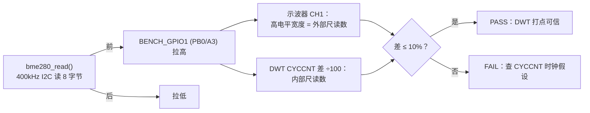
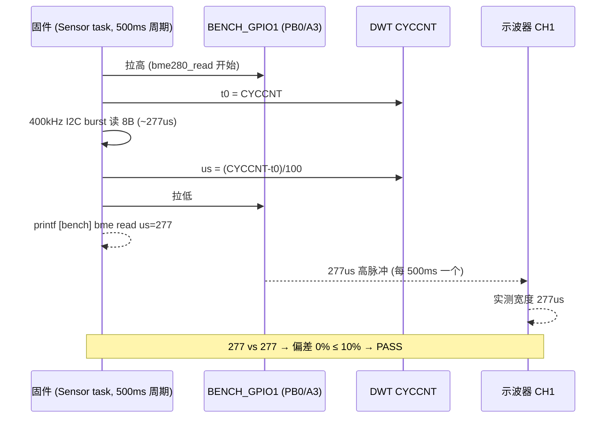

# T10 — DWT 打点可信度交叉验证报告（示波器 vs CPU 周期计数器）

> - **日期**：2026-11-19｜**分支**：m1-skeleton（`9c5450f` + 工作区 diag 修复，Step 3 收尾提交见本报告末尾）｜**板**：Nucleo-F411RE（100 MHz，console=ST-LINK VCP 115200）
> - **判定**：**PASS** — 示波器实测 277 µs vs DWT 固件读数 277 µs，偏差 0%（判据 ±10%）
> - **阅读前提**：本任务验证的是"量尺"本身可信，不涉及功能代码——**量尺不准，之后所有用 DWT 量出来的延迟主张都不成立**，所以它值得独立取证。

## 一、为什么测：仪器尺 vs 固件尺

固件里所有延迟主张（T6 的 I2C 100 ms 限界、T9 的队列压力周期）都靠一个内部尺子：**DWT 周期计数器**（CPU 每个时钟周期自增 1，100 MHz 下 100 个周期 = 1 µs）。尺子在 CPU 里面，外面的世界看不见——所以 T10 用第二把尺子（示波器）量同一件事，两把尺子的读数差 ≤10% 才算尺子可信。

两把尺子量的是同一个物理事件：固件把 BME280 的 I2C 读**整个包裹**在一个 GPIO 电平里（读开始拉高、读结束拉低），这个 GPIO 叫 `BENCH_GPIO1`：



## 二、过程

### 2.1 校准方波轮（探链自检，计划外加做）

正式测 277 µs 窄脉冲之前，用户要求先验证"示波器-探棒-板子"这条链本身没问题——方法：固件临时输出一个**1 s 高 / 1 s 低**的慢方波（`TEMP_SCOPE_CAL` 模式，Sensor 任务每 2 个 500 ms tick 翻转一次 PB0），时基放慢到 200 ms/div 肉眼可辨。

| 检查项 | 预期 | 实测 |
|---|---|---|
| 方波周期 | 2 s（高 1 s / 低 1 s） | ✓（串口 `[cal]` 每 1 s 翻转同步） |
| 幅度 | 高 ≈3.3 V / 低 ≈0 V | ✓ |
| 探棒位置 | A3（丝印 PB0） | **✗ 无波形 → 见 2.2** |

**顺带处理了测量环境问题**：台式机 USB 供电 + 示波器共地环路耦合 50 Hz 工频纹波。对策：探棒接地线缩短（弹簧地针/紧邻 GND）、边沿触发 + Normal 模式、光标卡在边沿 50% 交叉点量宽度——50 Hz 只叠加在垂直轴（幅度）上，不影响时间轴（宽度）读数，因此不威胁本次判定。

### 2.2 过程中发现的真实 bug：diag.c 引脚映射与 .ioc 标签不一致

校准方波在 A3 上**探不到**，但串口 `[cal] bench gpio HIGH/LOW` 每 1 s 精确翻转、`[mon]` 全指标健康——固件显然在跑。三层配置核对后抓到根因：

| 层 | 说 BENCH_GPIO1 是什么 | 状态 |
|---|---|---|
| `InduLogger.ioc` 第 115 行 | `PB0.GPIO_Label=BENCH_GPIO1`（main.h 宏同） | 设计意图 |
| `diag.c` `diag_bench_gpio_set(1,...)` | **驱动 PA1**（`GPIOA PIN_1`） | ← 运行时实际，与 .ioc 相反 |
| `diag.h` 旧注释 | "BENCH_GPIO1 = PA1 (A1)" | 与 diag.c 自洽，但违背 .ioc |

即：**打点信号一直在 PA1（丝印 A1）上，PB0 从未被驱动过**——T6 时代 DWT 量 I2C 失败 51.6 ms 时 GPIO 打点就已经打错脚了，只是当时没有示波器所以无从发现。

**修复**（`diag.c`/`diag.h`，随本报告提交）：`set(1,...)→PB0`、`set(2,...)→PB1`，与 .ioc 标签对齐；`diag_dwt_init` 同步初始化 PB0+PB1（PA1 初始化移除）。

```c
void diag_bench_gpio_set(int n, bool on)
{
  if (n == 1) {
    /* BENCH_GPIO1 = PB0 (Arduino A3) — label mapping per InduLogger.ioc. */
    HAL_GPIO_WritePin(GPIOB, GPIO_PIN_0, on ? GPIO_PIN_SET : GPIO_PIN_RESET);
  } else if (n == 2) {
    /* BENCH_GPIO2 = PB1 (Arduino A4). */
    HAL_GPIO_WritePin(GPIOB, GPIO_PIN_1, on ? GPIO_PIN_SET : GPIO_PIN_RESET);
  }
}
```

修复后重烧，**A3 上 1 s/1 s 方波立即可见**——探链验证通过，这也反向证明了修复的正确性。

### 2.3 正式交叉验证轮

`TEMP_SCOPE_CAL` 关闭、恢复正式采样固件（TEMP 计时打印保留在本轮：每 500 ms 采样打印一次 `[bench] bme read us=N`）。

**内部尺（DWT，串口侧 90 s 窗口全量统计）**：

| 指标 | 结果 |
|---|---|
| 打印数 | 160 行 ≈ 2 Hz（500 ms 采样周期 ✓） |
| 读数分布 | `us=277` ×142 + `us=278` ×18（离散 <0.4%） |
| 复位 | 仅烧录的 1 次软件复位 |

**外部尺（示波器，用户读数）**：A3 脉冲宽度 **277 µs**。

**判定**：277 vs 277，偏差 **0%**，判据 ±10%（249~305 µs）——**PASS**。



### 2.4 收尾状态

- TEMP 代码（计时打印 + 校准模式）全部移除，`app_sensors.c` 恢复到与已提交版本逐字一致（`git checkout` 恢复 + `git diff` 仅剩 diag 修复）。
- 干净构建 82560 text / 504 data / 35792 bss，0 告警；boot sanity：boot 后 0 条 `[bench]`/`[cal]` 残留，BME/MPU init ok，`[mon]` wm=372/691/456 健康，零复位。

## 三、方法论沉淀

1. **校准波先行**：测窄脉冲前先用慢方波验证探链——链路问题（探棒、接地、触发）与信号问题（打点没在跑）在慢方波上一眼区分，避免在窄脉冲上盲调。
2. **物理证据优先于配置考古**：A3 无波形 + 串口证明固件在跑 → 唯一解释是"打点不在 A3"——三层配置核对（.ioc/main.h/手写代码）后代码层被抓，比反复 grep 配置文件更快更可靠。
3. **两把尺子差 0% 不是巧合**：DWT 与 GPIO 写入同在 100 MHz AHB 域，偏差主要来自 GPIO 写的流水线开销（本例 <1 µs）；±10% 判据为未来更短的脉冲（µs 级）留了工程余量。

## 四、边界（没测什么）

- 只交叉验证了 **BME280 读路径**（277 µs，最常用的事件）；init 路径（~11.3 ms）与失败路径（~51.6 ms，裸总线时代数据）由同一打点机制覆盖，机制可信度随读路径判定成立，未单独复测。
- DIAG_PULSE 8 周期打点宏与 BENCH_GPIO2（PB1/A4）基础设施存在但未用，留作 M2 事件打点扩展位。
