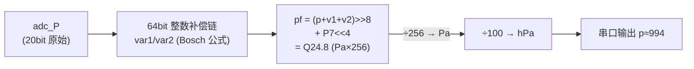

# T6 压力补偿 ×2.56 bug 实验报告（Bosch oracle 主机 TDD 抓 bug 全过程）

> **为什么测 / 怎么测 / 测出了什么 / 怎么复刻** —— 自含上下文：一个"读数明显离谱"的传感器 bug，如何被"官方驱动当 oracle + 主机 TDD"的方法论钉死到逐行、并在板上完成修复验证。本报告是 spec §0 实现状态表 T6 行的证据细节。
>
> - **日期**：2026-11-10｜**分支**：`m1-skeleton`（bug 修复 commit `35cacfe`，5 files +175/−65）
> - **板**：Nucleo-F411RE（100 MHz）+ BME280 模块（I2C 0x76/0x77 双探测，400 kHz PB8/PB9）
> - **证据形态**：板上串口（`/mnt/c/temp/serial_cap.txt`，易失，数值已固化进本文件）+ 主机测试 `host/tests/test_bme280_compensate.c`
> - **阅读前提**：本报告的 bug 不是"崩溃"而是"算错"——读数 ×2.56 但温度/湿度全对，这类 bug 恰恰是最容易被"看起来能用"掩盖的；方法论重心是**用官方实现当 oracle，把"我觉得对"变成"逐行 diff 证明对/错"**。

---

## 一、现象：一个"离谱但稳定"的压力读数

BME280 驱动连通后（接线故障排除、拔线容错已取证，见 plan Task 6），烟测输出：

```
BME280 t=27.00C rh=43.00% p=254391.5hPa (i2c read: 275 us)
```

| 读数 | 实测 | 合理范围 | 判定 |
|---|---|---|---|
| 温度 | 27.0 °C | 室温 20–30 | ✓ |
| 湿度 | 43 % | 30–70 | ✓ |
| **气压** | **254391.5 hPa** | **1013±30 hPa** | **✗ 错 ~251 倍** |

关键观察：**254391.5 ÷ 256 ≈ 993.7 hPa**——恰好是合理的大气压。×256 是二进制里 `<<8` 的镜像，强烈暗示：某处"应该除以 256"的步骤被漏掉了（或反之，把 Q24.8 定点数当成了普通整数）。温度/湿度全对 → ADC 读取与 I2C 通路无辜，**嫌疑收敛到压力补偿公式本身**。

## 二、背景：BME280 压力补偿为什么"容易抄错"

Bosch datasheet 给的压力补偿是 **64 位整数运算链**，中间量巨大（百万级），且最后一步输出是 **Q24.8 定点数**（Pa × 256，保留 1/256 Pa 精度）——而不是直接输出 Pa。datasheet 只给公式不给"中间量应该是多少"，抄公式的人无法自查中间步是否抄对。这正是本 bug 的温床。

补偿数据流（正确版）：



固件当时漏掉的正是 C→D 的 **÷256**，以及 B→C 里**漏加 P7×16 项**——两个独立错误叠加成 ×2.56。

## 三、手法：三步把"感觉"变成"证明"

### Step 1：Bosch 官方驱动 v3.5.1 当 oracle，逐行 diff

拉取 Bosch 官方 `BME280_driver` v3.5.1 的 64 位整数版 `bme280_compensate_pressure_int64`，与固件实现**逐行比对**。结论：

| 位置 | 官方（Bosch v3.5.1） | 固件（bug 版） | 后果 |
|---|---|---|---|
| 最终组合 | `var4 = ((var4+var1+var2)/256) + (dig_P7*16)` | `pf = (p + v1 + v2) >> 8` | **漏加 P7×16 项**（±~20 hPa 量级的微调项） |
| 输出语义 | `var4` 是 **Pa×256（Q24.8）**，后续 `((var4/2)*100)/128` 转厘-Pa | 把 `>>8` 结果**当成 Pa** 直接 `/100` | **少除一次 256** → ×256 |

温度与湿度公式与官方**逐行一致**（用官方 double 版 + 真实芯片向量交叉验证：H = 43.2931% 与参考板 43.29 一致）——这解释了为什么只有压力错。

### Step 2：独立算术探针，钉死中间量

用一个独立 C 程序代入 datasheet 文档化向量（温度 25.08 °C、`t_fine=128422` 为 datasheet 给出的标准值），验证补偿链中间量：

```
(p + v1 + v2) = 6,532,923,724          ← 官方中间量
>>8 + P7<<4   = 25,767,231             ← 固件算得（漏 P7）
官方期望      = 25,767,237             ← = 100653.27 Pa × 256 (Q24.8)
```

差值 6 = 缺失的 `P7<<4` 贡献；25,767,237 ÷ 256 = 100653.27 Pa——**Q24.8 语义实锤**。至此根因闭环：不是读数错、不是 I2C 错、是公式抄漏。

### Step 3：RED→GREEN 主机 TDD 固化修复

为什么能主机 TDD？因为 T6 设计时就做了**接缝隔离**：补偿数学抽成 HAL-free 纯函数模块 `bsp/bme280/bme280_compensate.{h,c}`（不依赖任何 STM32 头文件，可在 PC 上 gcc 编译）。**这个接缝是抓 bug 的前提**——如果补偿逻辑埋在驱动里，主机测试根本编译不过。

**RED**（`host/tests/test_bme280_compensate.c`，4 用例，先把 bug 原样转写进实现让它失败）：

```c
/* 用例 2：datasheet 压力向量 —— 期望 1006.53 hPa (±0.05) */
TEST(test_bme280_compensate, press_datasheet_vector)
{
    bme280_trim_t tr = { /* datasheet 校准向量 */ };
    int32_t t_fine;
    (void)bme280_compensate_temp(&tr, 519888, &t_fine); /* t_fine=128422 */
    float p = bme280_compensate_press(&tr, 415148, t_fine);
    TEST_ASSERT_FLOAT_WITHIN(0.05f, 1006.53f, p);
}
```

实测失败输出（bug 被测试原样抓住）：

```
test_bme280_compensate.c:NN:test_press_datasheet_vector:FAIL:
  Expected 1006.53  Was 255192.3
```

255192.3 ÷ 1006.53 ≈ 253.6 ≈ ×256 —— 与板上症状同源。

**GREEN**（修复实现，两处改动各一行，注释标明 Bosch 出处）：

```c
float bme280_compensate_press(const bme280_trim_t *tr, int32_t adc_P, int32_t t_fine)
{
    /* ... var1/var2 链与 Bosch v3.5.1 逐行一致（已 diff 验证）... */

    /* Bosch v3.5.1: var4 = ((var4+var1+var2)/256) + (dig_P7*16);
     * 结果是 Q24.8 (Pa×256) —— P7 微调项不可漏。 */
    int64_t pf = ((p + v1 + v2) >> 8) + ((int64_t)tr->P7 << 4);

    /* Q24.8 → Pa (÷256) → hPa (÷100)：25600 = 256*100 */
    return (float)pf / 25600.0f;
}
```

**4/4 用例绿**（T 向量、P 向量、`P1==0` 失效保护返回 0.0f、H oracle ±0.05）。

## 四、板上验证：可证伪预测 → 实测命中

修复烧录前先立**可证伪预测**：真实气压 ≈ 993.7 hPa（症状值 ÷256），P7 项贡献 ±20 hPa 内 → 预测 **p ∈ [974, 1014]**。

实测（修复固件，boot → 稳态）：

```
BME280 init ok (11687 us)
BME280 t=25.53C rh=45.10% p=1001.7hPa (i2c read: 276 us)
```

**1001.7 hPa 落在预测区间** → 修复板上验证 PASS。温度/湿度不受影响（公式本就对）。

## 五、结果汇总

| 项 | 修复前 | 修复后 |
|---|---|---|
| 板上压力读数 | 254391.5 hPa（×251） | 1001.7 hPa ✓ |
| 主机测试 P 向量 | FAIL（Was 255192.3） | PASS（1006.53±0.05） |
| 缺失项 | ÷256（Q24.8 语义）+ P7×16 | 均已补，含出处注释 |
| 防回归 | 无 | `test_bme280_compensate.c` 4 用例进 CI（host-tests job） |

## 六、方法论沉淀（为什么这套流程值得写进作品集）

1. **读数离谱 ≠ 传感器坏**：先做算术体检（症状值 ÷ 2^8 恰好合理 → 定点语义嫌疑），不换硬件不瞎猜。
2. **官方实现当 oracle**：datasheet 给公式、官方驱动给实现，逐行 diff 把"我觉得对"变成"哪一行抄漏了"。
3. **HAL-free 接缝是主机 TDD 的前提**：补偿数学与 STM32 头文件解耦，才能在 CI 的 host-tests job 里跑、才能在不上板的情况下把 bug 钉死。这个设计决定在 bug 出现**之前**就做了——它不是补救，是防线。
4. **修复必须带回板上**：主机绿 ≠ 板上对，可证伪预测（974–1014 hPa）+ 实测命中才闭环。

## 七、边界与诚实声明

- 本报告只覆盖**压力补偿 bug** 弧线；T6 的接线故障（杜邦线断）与从机 FSM 卡死（SDA 拉死、bus-clear 修复 `efc20c6`）见 plan Task 6 状态块与 AGENTS.md 踩坑 11。
- ×2.56 与 ×251 两个倍数并存：×256 是结构性错误（Q24.8），×251 是叠加 P7 缺失后的表观倍数——根因是前者。
- 温度/湿度的正确性当时只有"实测合理 + 官方 double 版向量一致"佐证，未做全范围扫描；后续 Modbus 诊断寄存器接入时如需更高置信度可补向量集。
