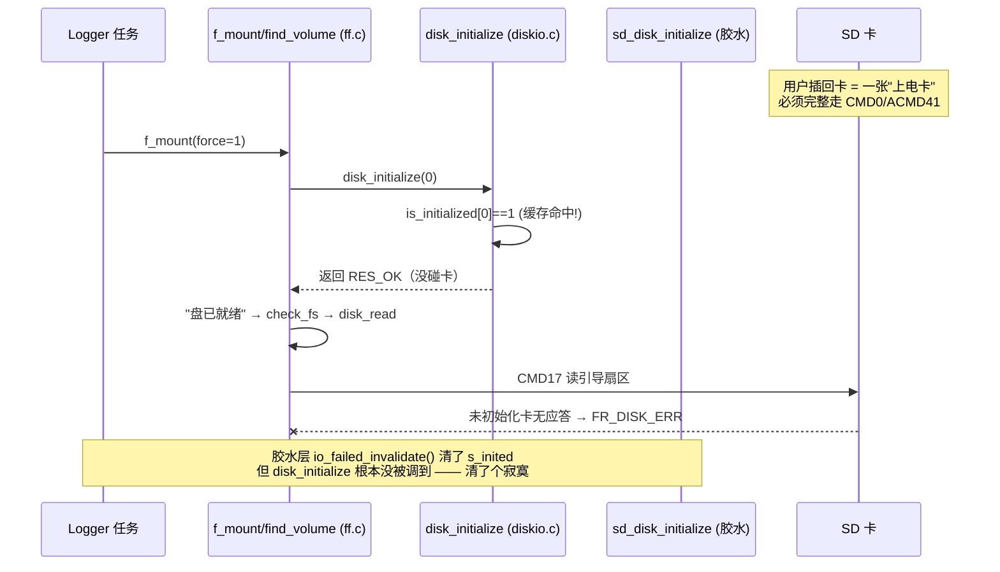

# T8 SPI-SD + FATFS 实验报告：三个故障注入案件 + ST diskio 缓存 bug 排查全过程

> **为什么测 / 怎么测 / 测出了什么 / 怎么复刻** —— 自含上下文：SD 记录功能的三类故障注入取证，以及排查中发现并修复的一个真实可靠性缺口（ST 私有 diskio 层的初始化缓存）。本报告是 spec §0 实现状态表 T8 行的证据细节。
>
> - **日期**：2026-11-12｜**分支**：`m1-skeleton`（功能 commit `815f3ca`，10 files +624/−7；文档 `2dca99f`）
> - **板**：Nucleo-F411RE + SPI-SD 模块（6 pin，板载 3.3V LDO + 电平转换）+ FAT32 卡；SPI1 PB3(SCK)/PB4(MISO)/PB5(MOSI) + PA4(CS)，初始化 400 kHz → 数据 6.25 MHz
> - **证据形态**：板上串口（数值已固化进本文件）+ flash 字节级读回比对（`CubeProgrammer -u` + `cmp`）
> - **阅读前提**：本报告的核心 bug 的症状是"插回卡永远挂载失败，且**烧录验证成功却像旧固件还在跑**"——三轮排查都差点被"固件没烧进去"带偏；最终靠**字节级证据**而非假设翻案。判负即判胜原则同样适用于故障注入：`append failed` + 计数递增不是故障，是被测防线在正确报错。

---

## 一、功能与主张：SD 记录要证明什么

SD 记录（T8）落的是 **reliability + observability** 两条主张的存储端：数据要能持久化（断电不丢）、存储故障要能自愈（拔卡/脏卡）、故障要可观测（错误计数器）。plan Task 8 定义了三个故障注入案件：

| 案件 | 注入动作 | 预期（防线正确时） |
|---|---|---|
| ① 基线 | boot 挂载 + append + 回读 | `sd: mounted, readback: boot,ok` |
| ② 拔卡 | 运行中拔卡 | 有界失败（100ms 限界）+ `ERR_SD_WRITE` 递增 + 板不死 |
| ③ 复插自愈 | 插回 | 自动重挂载 ≤ 数秒，append 恢复 |
| ④ 脏卡 | 写中 NRST ×3 | 每次 boot 重挂载 + 回读 ok，截断行容差 |

案件 ①②④ 一次通过；**案件 ③ 首次执行暴露了本报告的主角**——插回卡后永远挂载失败。

## 二、Bug 现场：插回卡 = 永久失败，且"烧录成功却旧行为"

### 2.1 症状链

拔卡后插回，串口反复打出（每 2s 一轮）：

```
sd: append failed (1, err cnt=1)
sd: mount retry failed (1, diag=0x09FF0000, inits=1)   ← inits 永远 = 1，冻结
sd: mount retry failed (1, diag=0x097F0000, inits=1)
```

三个线索同时在场：`FR_DISK_ERR(1)`、诊断字 stage-1（CMD0 阶段无应答，`0xFF` = MISO 无 R1 帧）、**`inits=1` 冻结**。`inits` 是 diskio 胶水层的初始化执行计数——它冻结意味着 **`disk_initialize` 没有被重新执行**，但我们的胶水代码明明在每次 I/O 失败时清了重 init 标志。

### 2.2 三轮"假 stale firmware"弯路（诚实记录）

修复第一版（I/O 失败清 `s_inited`）烧录后症状不变，连续三轮怀疑"烧录没成功/板子在跑旧固件"：

| 轮次 | 现象 | 当时结论 | 事后看 |
|---|---|---|---|
| A | 重试签名 `(1, 0x097F…, inits=1)` | "像旧固件" | **这签名本身就是 bug**（缓存短路后走不到重 init） |
| B | boot 横幅 + `readback: boot,ok` 后静默 | "旧固件？但挂载又成功了" | 用户没及时拔卡，正常成功案例 |
| C | 窗口结束前 4s 才拔卡，只捕到 2 轮重试 | 又怀疑旧固件 | 窗口时序问题 |

### 2.3 字节级翻案（方法论转折点）

不再猜，直接读板子 flash 与构建产物比对：

```bash
# 参数顺序：地址 大小 文件（WSL 路径对该 exe 不通，用 C:\temp）
STM32_Programmer_CLI -c port=SWD -u 0x08000000 0x20000 C:\temp\flash_dump.bin
cmp /mnt/c/temp/flash_dump.bin /mnt/d/InduLogger/stm32/build/InduLogger.bin
# cmp: EOF on build/InduLogger.bin after byte 79656   ← 前 79656 字节逐字节一致
```

**板子确实在跑新固件** → 唯一结论：**行为模型错了，不是 flash 错了**。排查方向从"烧录流程"转向"读 FatFs 源码"。

## 三、根因：ST 私有 diskio.c 的 `is_initialized` 缓存

逐文件读链路（`user_diskio.c` → `ff.c` → `diskio.c`），三个文件里两个是清白的，一个是元凶：

| 文件 | 结论 |
|---|---|
| `user_diskio.c`（ST 生成层） | 委托胶水层完全正确（init/status/read/write/ioctl 五个口全通） |
| `ff.c`（ChaN FatFs R0.12c） | `f_mount` 正确清 `fs_type`，无缓存问题 |
| **`diskio.c`（ST 私有包装层）** | **元凶** ↓ |

```c
/* ST diskio.c —— ChaN 原版没有这层包装！ */
DSTATUS disk_initialize (BYTE pdrv)
{
  DSTATUS stat = RES_OK;
  if (disk.is_initialized[pdrv] == 0) {          /* ← 缓存：once-set, never-clear */
    stat = disk.drv[pdrv]->disk_initialize(disk.lun[pdrv]);
    if (stat == RES_OK) disk.is_initialized[pdrv] = 1;
  }
  return stat;                                    /* 缓存命中 → 直接返回"已就绪" */
}
```

**故障传播链**（为什么"看起来挂载成功、实际全盘皆输"）：



我们的失效失效清理（`io_failed_invalidate`）**一直在跑、一直无效**——它清的是胶水层自己的 `s_inited`，而缓存卡在 ST 包装层，胶水层被短路了。`nm`/`objdump` 确认 `io_failed_invalidate` 存在且被 `sd_disk_read` 调用——修复在、被缓存作废。

## 四、修复：两层失效 + 400 kHz 回退

```c
/* user_diskio_glue.c —— I/O 失败时的两层失效（board-proven） */
static void io_failed_invalidate(void)
{
  s_inited = 0;                    /* 层1：胶水自己的 init 标志 */
  disk.is_initialized[0] = 0;      /* 层2：ST diskio.c 的缓存
                                    * （extern Disk_drvTypeDef disk; ff_gen_drv.h）
                                    * 不清这层，find_volume 永远短路绕过重 init */
}
```

第二处是排查中顺藤摸出来的**第二个坑**：`sd_spi_init` 入口必须强制回 400 kHz——上一次成功 init 的尾巴把 SPI 提到 6.25 MHz，重 init 的 CMD0/ACMD41 阶段 SD 规范要求 ≤400 kHz，残留高速分频直接毁掉重 init：

```c
int sd_spi_init(void)
{
  /* SD 规范：ACMD41 完成前禁止 >400 kHz。上次 init 的快速分频会残留
   * 在 hspi1 里（board evidence：残留 6.25 MHz 时重 init 全灭）。 */
  if (spi_speed(SPI_BAUDRATEPRESCALER_256) != 0) {
    return sd_fail();
  }
  /* ... 74 clocks → CMD0 → CMD8 → ACMD41(HCS) → CMD58 → CMD59 ... */
}
```

> **速率裁定（vs plan）**：数据阶段 6.25 MHz（prescaler 16），不是计划写的 12.5 MHz——板上证据显示 12.5 MHz 在杜邦线 + 模块电平转换下边际不稳（`diag=0x030101AA` 循环）。记录为裁定，不掩盖。

## 五、板上验证：完整预期序列逐段命中

修复构建（79168 text）烧录后，600s 窗口捕到全序列：

| 串口片段 | 解读 | 在验什么 |
|---|---|---|
| `sd: mounted, readback: boot,ok`（boot 静默成功段） | 案件 ① | 基线 |
| `sd: append failed (1, err cnt=1)` | 拔卡瞬间 | 案件 ② 有界失败 |
| `sd: mount retry failed (3, diag=0x01FF0000, inits=2)` → `(3, …, inits=3)` | **`inits` 开始爬升** = disk_initialize 真的重跑了 = **缓存失效生效** | bug 修复的直接证据 |
| `sd: re-mounted after failure (err cnt=3)` | 插回 → 400 kHz 重 init 成功 → 重挂载，**≤4s** | 案件 ③ 自愈 |
| 之后静默至窗口结束，wm=215，零复位 | append 恢复 | 案件 ③ 收口 |
| （另一轮）NRST ×3：每次 boot 横幅 + `reset cause: external-pin` + `sd: mounted, readback: boot,ok` | 案件 ④ 脏卡 | 写中复位容差 |

**四个案件全部 PASS。** 新签名 vs 旧签名对照（排查工具价值）：

| | 旧（缓存 bug 在） | 新（修复后） |
|---|---|---|
| FRESULT | 1 (FR_DISK_ERR，CMD17 打在未 init 卡上) | 3 (FR_NOT_READY，CMD0 阶段就无应答) |
| `inits` | 冻结 1 | 每轮 +1，爬升 |
| 复插后 | 永久失败 | ≤4s `re-mounted` |

## 六、方法论沉淀

1. **"烧录成功却旧行为"的第一反应用字节级证据回应，不重烧第三次**：`-u` 读回 + `cmp` 五分钟出结论，三轮假设烧掉的是信任。
2. **第三方/厂商"包装层"是隐性缓存高发区**：ChaN 原版 FatFs 没有这层缓存，ST 加了——文档不写、源码才见。接任何中间件先读它包了什么。
3. **失效清理必须清到"真正挡路的那一层"**：清自己模块的标志≠清系统状态。失效路径设计时问一句"谁还缓存着'就绪'？"
4. **初始化速率是协议约束不是实现细节**：跨 init 重入的驱动，入口先恢复协议要求的初始状态（400 kHz），出口才提速。
5. **诊断字投入产出比极高**：`diag=0x01FF0000` 一个字段（stage + R1 + inits）同时锁定了故障阶段、应答状态、init 执行次数——它就是本轮翻案的关键物证。

## 七、边界与诚实声明

- 本轮"插回卡 = 上电卡需完整重 init"与 T6 的"I2C 从机 FSM 卡死"是**两类不同故障**：前者是初始化状态机没跑（软件层缓存），后者是从机总线状态机真挂死（硬件行为，需 GPIO bus-clear，见 T6/`efc20c6`）。报告分开写，防混。
- 复插自愈的"≤4s"含 mount-retry 节拍（每 2s 一试）；未单独优化。
- `GET_SECTOR_COUNT`/`GET_BLOCK_SIZE` 返回 `RES_PARERR`（未实现 f_mkfs 路径）——已文档化，不影响记录功能。
- 三轮"假 stale"弯路是真实成本；字节级比对方法（踩坑 14）就是为不重复付这个学费而沉淀的。
