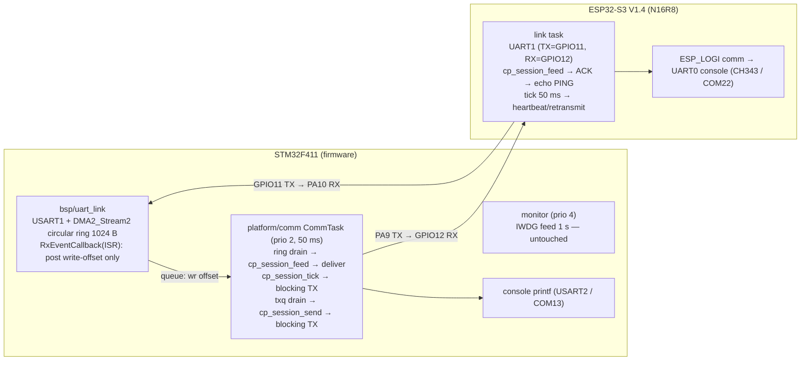

# M2.2 — UART Link + CommTask + ESP32 Echo — Design Spec

Date: 2026-11-25 · Branch: `m2-coproc` · Status: approved-in-chat, pending written review
Plan file (after approval): `docs/plans/2026-11-25-m2-2-uart-link.md`

## 1. Goal and scope

M2.2 is the project's **first board-level bring-up of the STM32↔ESP32 link**: a real
UART carrying the frozen M2.1 protocol (`coproc_proto` / `coproc_session`, zero protocol
changes), a new STM32 `CommTask`, and a new ESP32-S3 firmware that answers `PING` with
`ACK` + payload echo and runs the heartbeat/retransmit machinery on both ends.

Execution is split in three phases, risk low → high (ruling R6):

| Phase | Deliverable | Touches hardware? |
|---|---|---|
| **2.2a** | `esp/` IDF project builds; protocol lib compiles clean under xtensa; PING↔ACK loopback observable on the ESP's own console | ESP board only |
| **2.2b** | STM32 `bsp/uart_link` + `platform/comm` CommTask; ring-drain logic host-TDD'd; CubeMX DMA mode → Circular | STM32 side, wiring not yet joined |
| **2.2c** | Joined link, 7-item acceptance table (§7) evidenced by dual-port serial capture, report + AGENTS update | both boards |

Out of scope (explicit): RTC landing of `TIME_SET` (M2.3 prep, ruling R7), WiFi/MQTT,
BLE, Modbus, OTA, ESP firmware in CI (R8.6).

## 2. Verified environment facts (measured 2026-11-24/25, not assumed)

| Fact | Evidence |
|---|---|
| ESP board is **not** an official DevKitC-1: silkscreen `ESP32-S3 V1.4` (YD-style clone), module `N16R8` (16 MB flash + 8 MB OPI PSRAM), bridge = **WCH CH343**, `USB\VID_1A86&PID_55D3`, enumerated as **COM22** | live `Get-CimInstance` + user silkscreen read (ruling R3) |
| Onboard PCB antenna, no external antenna required (R4) | user ruling 2026-11-25 |
| ESP-IDF **v6.0.3** installed: IDF `D:\ESP32\v6.0.3\esp-idf`, tools `C:\Espressif\tools`, env entry = `& 'C:\Espressif\tools\Microsoft.v6.0.3.PowerShell_profile.ps1'` (R2) | `idf.py --version` returned `ESP-IDF v6.0.3` through that profile |
| STM32 side: `huart1` init 115200 8N1 TX+RX, app layer never uses it; `hdma_usart1_rx` = DMA2_Stream2/CH4 linked, both IRQs at NVIC preempt 5 = `configLIBRARY_MAX_SYSCALL_INTERRUPT_PRIORITY` (FromISR-legal); DMA Mode currently **`DMA_NORMAL`** at `stm32f4xx_hal_msp.c:258` | grep-verified 2026-11-23 (handover §2.1) |
| Console UART (`huart2`) is `UART_MODE_TX_RX` — console input ('p' trigger) needs no CubeMX change | `main.c:392` |
| Task map today: sensor 3 / monitor 4 / logger 1 / default Normal | `main.c` RTOS_THREADS |
| Protocol frozen: PING = "either direction, responder echoes payload unchanged" | `coproc-protocol-spec.md` §4 |

## 3. Architecture



Key structural decisions (approved as design points 1–7, R8):

1. **Ring drain, not ISR copy.** The ISR callback does the least possible: it reads the DMA
   counter (`wr = RING_SZ - CNDTR`) and posts the offset through
   `xQueueSendFromISR`. CommTask keeps its own `rd`, copies bytes out (two segments when the
   ring wraps — the streaming parser tolerates arbitrary chunking, so a frame split across the
   wrap boundary is fed as two `cp_session_feed` calls with no special case). If `wr` laps
   `rd` (task starved > one ring revolution ≈ 89 ms at 115200), the unread span is lost:
   `rd` jumps to `wr` and `rx_overrun++` — a *counted* physical-layer event, never a hang.
   Why not copy-in-ISR: a single staging buffer races with the next event; passing pointers to
   the live ring races with the DMA writer; the offset+drain pattern has neither.
2. **Blocking TX inside CommTask** (`HAL_UART_Transmit`, 100 ms timeout). Stop-and-wait
   guarantees one frame in flight, so TX is inherently serialized; 520 B ≈ 45 ms occupies
   only the prio-2 task itself and cannot starve monitor(4)/sensor(3).
3. **PING triggers**: one PING at boot (~1 s after scheduler start) plus one per console key
   `p` (CommTask polls `HAL_UART_Receive(huart2, …, 0)` each tick). No periodic application
   frames — so the "12 s idle = exactly 2 heartbeats" observation window stays clean.
4. **File placement**: `stm32/bsp/uart_link.{c,h}` (HAL plumbing) + `stm32/bsp/uart_ring.{c,h}`
   (pure-C ring math, host-TDD) + `stm32/platform/comm/app_comm.{c,h}` (CommTask + session
   assembly + `app_comm_send()` API) + new top-level `esp/`.
5. **All protocol state static**: `cp_session_t` (1100 B), tx/rx scratch (`cp_frame_t` 516 B,
   520 B buffers), ring 1024 B, txq 4 × 520 B — file-scope globals, never task stacks.
   CommTask stack 1024 words (4 KB).
6. **`TIME_SET` on STM32** → 4-byte big-endian Unix time stored in a RAM variable + `[comm]`
   log line; RTC landing deferred to M2.3 prep (R7).
7. **Link uses UART1 on the ESP side (GPIO11 TX / GPIO12 RX); UART0 stays the USB console.**
   Why: the CH343 bridge is wired to UART0 (GPIO43/44); if the STM32 also hung on UART0, the
   bridge TX and PA9 would drive ESP RX simultaneously whenever `idf.py monitor`/`flash` is
   active — two outputs, one line, corrupted both ways. Separate peripherals also give the
   dual-timestamp evidence capture (§7) two independent log streams: COM13 (STM32) and
   COM22 (ESP).

**Echo-role ruling (R9)**: the protocol's "PING responder echoes payload unchanged" is
implemented **only on the ESP side**. STM32 logs a delivered PING (its own echo returning)
but never re-echoes — otherwise the echo would ping-pong forever. STM32's session still
auto-ACKs the incoming echo (session layer does this for every non-ACK frame), which is
correct and also advances ESP's `tx_acked`.

## 4. STM32-side detail

### 4.1 `bsp/uart_ring` (pure C, host-tested)

```c
typedef struct { uint8_t *buf; uint16_t size; uint16_t rd; } uart_ring_t;
/* wr derived, never stored: avoids ISR/task shared-write hazard. */
void     uring_init(uart_ring_t *r, uint8_t *buf, uint16_t size);
size_t   uring_drain(uart_ring_t *r, uint16_t wr, uint8_t *dst, size_t max, bool *overrun);
```

`uring_drain(r, wr)` copies `rd → wr` modulo `size`, at most `max` bytes, advances `rd`;
when the unread span ≥ `size` it resets `rd = wr` and sets `*overrun`. Tests: no-data,
normal span, wrap split, overrun, max clamp. (New host suite; existing 23 protocol tests
untouched.)

### 4.2 `bsp/uart_link` (HAL plumbing)

- `uart_link_init()`: `HAL_UARTEx_ReceiveToIdle_DMA(&huart1, ring_buf, RING_SZ)` once —
  in **Circular** mode HAL keeps the DMA running and only the IDLE/half/full events fire
  `HAL_UARTEx_RxEventCallback`. (CubeMX change: `Dma.USART1_RX.0.Mode` NORMAL → **CIRCULAR**,
  ruling R5; after regeneration the USER CODE regions are diff-checked before building.)
- Callback override (ISR): compute `wr = RING_SZ - __HAL_DMA_GET_COUNTER(hdma)`;
  post `wr` via `xQueueSendFromISR` (length queue, depth 8, drop-count on full).
  Ignore `Size` semantics debate by deriving `wr` from CNDTR directly.
- `uart_link_read(dst, max)`: task context; waits event with 0-timeout poll each tick,
  then `uring_drain`.

### 4.3 `platform/comm/app_comm` (CommTask)

- Created in the `RTOS_THREADS` USER CODE block: `xTaskCreate(app_comm_task, "comm", 1024, NULL, 2, …)`
  — prio 2 < monitor 4 (T9 watchdog discipline).
- Owns the single `cp_session_t` (static). **Every** `cp_session_*` call happens in this task;
  upper layers only ever call `app_comm_send(cmd, payload, len)` which copies into the txq —
  the serialization point mandated by stop-and-wait (`CP_ERR_BUSY` contract).
- 50 ms loop (period chosen ≪ 500 ms ACK timeout so retransmit timing is honest):
  1. `now = HAL_GetTick()`; drain RX → feed loop (handover pattern:
     `while (off < n) { st = feed(…, data+off, …); if (st == CP_ERR_NO_FRAME) break; off += consumed; }`);
     emitted `ack_buf` → blocking TX; delivered frame (`out->cmd != 0`): `TIME_SET` → RAM + log;
     `PING` → log "echo received"; other → log.
  2. txq drain → `cp_session_send` → blocking TX (one per tick; txq depth 4).
  3. `cp_session_tick` → if emitted, blocking TX (buffer ≥ `CP_FRAME_MAX`).
  4. console poll: `p` → enqueue PING payload `"abc"` (3 B — acceptance item 2).
  5. link-state edge → `[comm] link UP/DOWN` line; every 10 s → `[comm] tx=… acked=…
     retry=… fault=… rx=… dup=… crc=… orr=…` line.
- Static footprint ≈ 5.3 KB (session 1100 + ring 1024 + txq 4×520 + frame/buffers ~1 KB).

### 4.4 Interrupt legality (why no ISR rework is needed)

USART1 and DMA2_Stream2 IRQs are already at NVIC preempt 5 = `MAX_SYSCALL`, so
`xQueueSendFromISR` from `HAL_UARTEx_RxEventCallback` is legal (priority numerically ≥ 5).
No new IRQs; TIM11/SysTick untouched; IWDG feed path (monitor task) untouched.

## 5. ESP32 side (`esp/`, IDF v6.0.3)

```
esp/
├── CMakeLists.txt              # standard IDF top-level
├── sdkconfig.defaults          # pins the N16R8 facts (below)
├── components/coproc_proto/
│   └── CMakeLists.txt          # SRCS = ../../stm32/middleware/coproc_proto/*.c (same files, zero copies)
└── main/
    ├── CMakeLists.txt  Kconfig # COPROC_SUPPRESS_ACK (bool, default n)
    └── app_main.c  link_task.c
```

- `sdkconfig.defaults`: `CONFIG_IDF_TARGET="esp32s3"`, `CONFIG_ESPTOOLPY_FLASHSIZE_16MB=y`,
  `CONFIG_SPIRAM=y` + `CONFIG_SPIRAM_MODE_OPI=y` — because N16R8's PSRAM is OPI and a
  default 4 MB flash setting would generate a wrong partition table (handover §2.2 warning).
- UART1: TX GPIO11, RX GPIO12, 115200 8N1, 1024 B RX driver buffer, `uart_read_bytes` loop.
- `now_ms = esp_timer_get_time() / 1000`; **no app-level deadline comparisons** — all timing
  lives in `cp_session_*` (wrap-safe by pitfall 20); any new ESP-side timing code must use
  signed-diff comparisons.
- Behavior: feed → write `ack_buf` (unless `SUPPRESS_ACK`) → on delivered `PING`,
  `cp_session_send(PING, same payload)` → write; `cp_session_tick` every 50 ms (same task,
  `uart_read_bytes` timeout 10 ms + deadline accumulate). `ESP_LOGI("comm", …)` prints
  link edges + 10 s counter lines to UART0 console (visible on COM22 monitor).
- Build/flash from WSL via `scripts/idf.ps1` wrapper (profile-dot-source + `idf.py -p COM22 …`),
  per handover §2.3 (no triple-nested quoting in bash).

## 6. Wiring (hardware ops — executed only after explicit user confirmation, AGENTS §9)

| # | Action | Expect | Verifies |
|---|---|---|---|
| 1 | ESP board keeps its own USB to PC (COM22) — **never powered from Nucleo 3V3** (WiFi bursts 350–500 mA crash the STM32 rail, 2026-11-20 ruling) | board stays enumerated | supply isolation |
| 2 | ESP **GPIO11 → Nucleo PA10 (USART1_RX)**, ESP **GPIO12 ← Nucleo PA9 (USART1_TX)**, **GND ↔ GND**; both 3.3 V logic, direct | — | physical link |
| 3 | Confirm Arduino-header TX/RX pins free of other jumpers | — | pin conflict |
| 4 | Flash separately: STM32 `make flash` (ST-Link), ESP `idf.py -p COM22 flash` | both banners | firmware identity |

## 7. Acceptance criteria (all 7 green ⇒ M2.2 ✅ in the report)

| # | Action | PASS condition | What it proves |
|---|---|---|---|
| 1 | Wire up, flash both | both banners; STM32 `reset cause:` shows no *new* iwdg beyond the normal post-flash one | link + no IRQ/task interference with watchdog timing |
| 2 | STM32 PING (3 B payload) | ESP logs ACK sent + echo; STM32 `[comm]` shows `tx_acked++`, `tx_seq` advanced, "echo received" | byte alignment + CRC integrity on real UART |
| 3 | Idle 12 s | each side sees exactly 2 HEARTBEATs (5 s period), no app frames | heartbeat path driven under RTOS on both ends |
| 4 | Rebuild ESP with `SUPPRESS_ACK=y` | STM32 `retry=3` → `fault=1`, `link DOWN` | retransmit/fault chain reproduces host-tested behavior on hardware |
| 5 | Unplug ESP→STM32 wire 30 s, re-plug | DOWN during; after re-plug first legal frame → `link UP`, traffic resumes, **no reset** | link self-heal (M1 cable-pull discipline) |
| 6 | Run 30 min | `crc=0` on clean wiring (nonzero → log and investigate supply/ground loop; pitfall 15) | signal integrity |
| 7 | Watch throughout | LED heartbeat continuous; no new iwdg reset | CommTask/DMA zero disturbance to the three M1 tasks |

Boundary attribution: CRC errors / occasional lost frames = physical layer (counted, not
FAIL); wrong ACK semantics or SEQ progression = protocol FAIL; any iwdg reset = integration
FAIL. Evidence: dual serial capture — `scripts/serial_capture.sh` gains an optional port
argument (it matches `"Virtual COM Port"` only, so COM22/CH343 needs the new parameter);
timestamps from both files cross-checked in `docs/reports/m2-2-uart-link.md`.

## 8. CI / gates

- Host suite grows by the `uart_ring` tests; all existing suites unchanged.
- Full CI-equivalent cppcheck (whole directory list + `--error-exitcode=1`) run locally
  before every push (pitfall 21); `bsp/` and `platform/` are already in the scanned list.
- MISRA addon step unchanged (`stm32/middleware` only).
- `esp/` firmware: manual builds only in M2.2 (R8.6); revisit at M2.3.
- Pushes: explicit refspecs `refs/heads/m2-coproc` to origin + gitee (pitfall 19).

## 9. Ruling log (this milestone)

| ID | Date | Ruling |
|---|---|---|
| R2 | 2026-11-24/25 | ESP-IDF installed v6.0.3 (D:\ESP32 + C:\Espressif\tools); satisfies "≥5.5" |
| R3 | 2026-11-25 | Board identity: clone `ESP32-S3 V1.4`, module N16R8, bridge CH343 = COM22 — **not** official DevKitC-1; AGENTS §5 to be updated at 2.2c close |
| R4 | 2026-11-25 | Onboard antenna, no external antenna (M2.3 precondition closed) |
| R5 | 2026-11-23/25 | CubeMX DMA Mode → CIRCULAR approved (with USER CODE diff check after regen) |
| R6 | 2026-11-25 | Three-phase split 2.2a → 2.2b → 2.2c approved |
| R7 | 2026-11-25 | "RTC basic init" pulled out of the deferred pool to before M2.3 |
| R8 | 2026-11-25 | Design points 1–7 approved (ring drain / blocking TX / boot+`p` PING / file placement / static alloc / TIME_SET→RAM + no ESP CI / UART1 link + UART0 console) |
| R9 | 2026-11-25 | Echo responder = ESP only; STM32 logs delivered PING but never re-echoes (prevents infinite ping-pong) |
