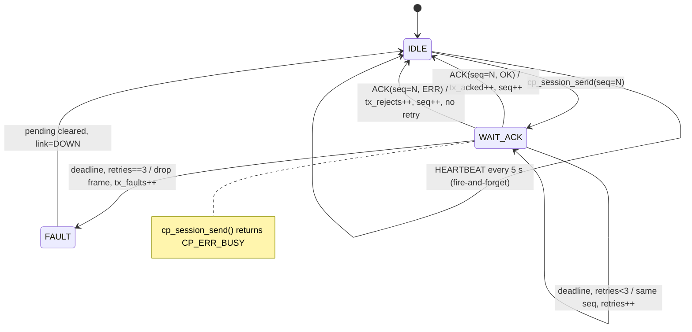
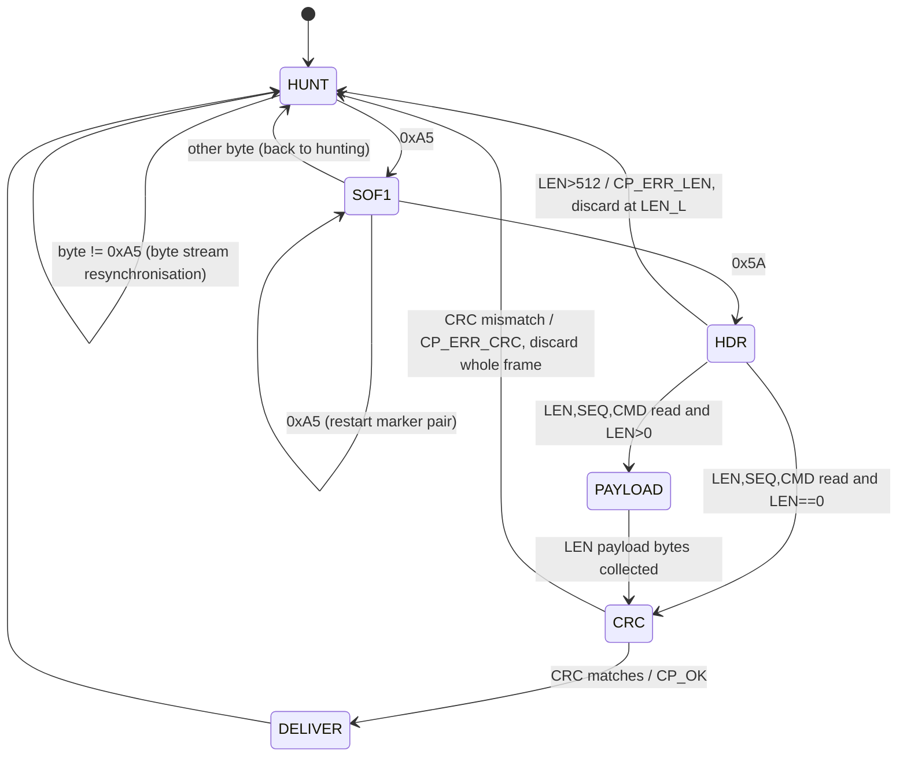
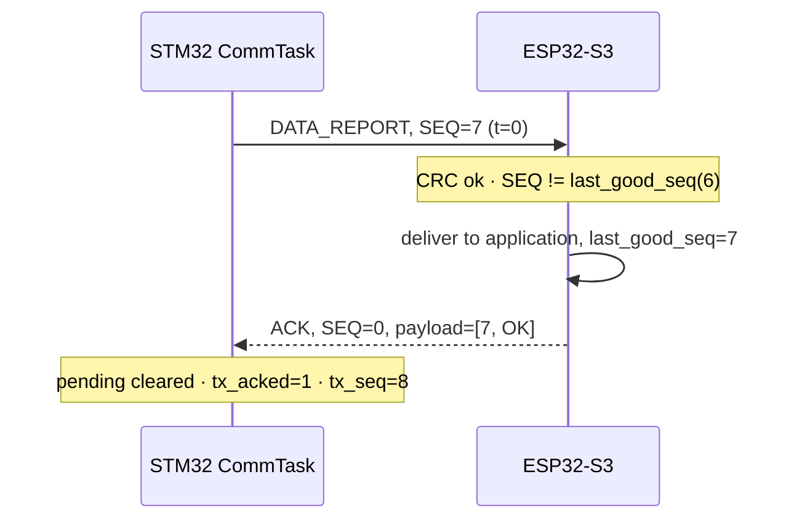
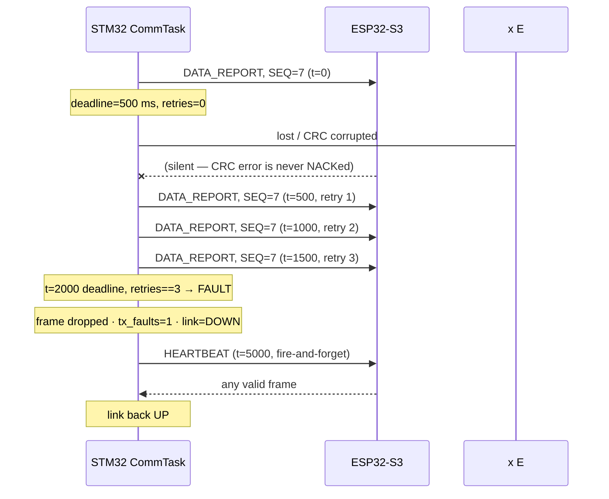

# STM32 ↔ ESP32-S3 Coprocessor Link Protocol

**Version:** v1 draft (M2.1) · **Status:** implemented and host-tested · **Applies to:** `stm32/middleware/coproc_proto/`

This document is the normative specification of the serial link protocol between the
STM32F411 logger application and the ESP32-S3 communication coprocessor. It is the
standalone deliverable promised in the design spec §15: implementers on either side read
this instead of reverse-engineering code. Every rule below is pinned by at least one of the
23 host tests listed in §10.

---

## 1. Overview

- **Purpose:** carry structured messages (sensor data, network status, Wi-Fi configuration,
  time synchronisation) between the STM32 logger and the ESP32-S3 coprocessor over a UART.
- **Shape:** byte-oriented, binary, big-endian for every multi-byte field. No text encoding,
  no escaping — framing is done by a fixed start-of-frame marker plus an explicit length,
  so an arbitrary payload byte value is always legal.
- **Reliability:** stop-and-wait with per-frame acknowledgement, bounded retransmission,
  duplicate suppression, keepalive heartbeats and link-loss detection.
- **Library location:** `stm32/middleware/coproc_proto/` — pure C11, no HAL, no RTOS, no
  dynamic allocation, no mutable global state. All timing decisions take `now_ms` as a
  parameter, so the same sources compile unchanged on the STM32 and on the ESP32 (ESP-IDF).
- **Layering:** the frame layer (`coproc_proto.{h,c}`) encodes and decodes frames; the
  session layer (`coproc_session.{h,c}`) adds acknowledgement, retransmission, de-duplication,
  heartbeat and link state. The STM32 `CommTask` (M2.2) only calls these APIs; it owns no
  protocol state.

## 2. Frame format

| Offset | Field | Size | Value / meaning |
|---|---|---|---|
| 0 | `SOF0` | 1 | `0xA5` — start of frame, byte 1 |
| 1 | `SOF1` | 1 | `0x5A` — start of frame, byte 2 |
| 2 | `LEN_H` | 1 | payload length, high byte |
| 3 | `LEN_L` | 1 | payload length, low byte (`LEN` = 0…512) |
| 4 | `SEQ` | 1 | sender sequence number (fixed `0` in `ACK` frames — §4) |
| 5 | `CMD` | 1 | command code (§4) |
| 6 | `PAYLOAD` | `LEN` | command-specific bytes, 0…512 (`CP_PAYLOAD_MAX`) |
| 6+`LEN` | `CRC_H` | 1 | CRC-16, high byte |
| 7+`LEN` | `CRC_L` | 1 | CRC-16, low byte |

- **Total frame size** = 8 + `LEN` bytes (minimum frame: 8 bytes, empty payload).
- **Maximum frame size** = `CP_FRAME_MAX` = 520 bytes (8 + 512).
- `LEN` counts **payload bytes only**; header and CRC are not included.

## 3. CRC

- **Algorithm:** CRC-16/CCITT-False — polynomial `0x1021`, initial value `0xFFFF`,
  no input/output reflection, final XOR `0x0000`, big-endian ("hi first") bit order.
- **Coverage:** offsets `2 … 5+LEN` inclusive, i.e. `LEN_H`, `LEN_L`, `SEQ`, `CMD` and the
  whole payload. The two `SOF` bytes are **excluded** (a receiver must be able to compute the
  CRC before it trusts the marker pairing, and resynchronisation never depends on CRC).
- **Placement:** the two CRC bytes follow the payload, high byte first.

Worked examples (both are golden vectors in the test suite):

| Input | Result |
|---|---|
| CRC of ASCII `123456789` (standard check value) | `0x29B1` |
| Heartbeat frame — `LEN=0, SEQ=0, CMD=0x02` → CRC of `00 00 00 02` | `0xA482` → full frame `A5 5A 00 00 00 02 A4 82` |

## 4. Command set

| CMD | Code | Direction | Payload | ACK |
|---|---|---|---|---|
| `PING` | `0x01` | either | opaque, 0…512 B | yes — responder echoes the payload unchanged |
| `HEARTBEAT` | `0x02` | either | empty | **no** (§6) |
| `DATA_REPORT` | `0x10` | STM32 → ESP32 | recorded sample block | yes |
| `DIAG_REPORT` | `0x11` | STM32 → ESP32 | diagnostics / health block | yes |
| `MQTT_PUB` | `0x20` | both | publish request / delivery | yes |
| `MQTT_SUB` | `0x21` | both | subscribe command / event | yes |
| `WIFI_CONFIG_SET` | `0x30` | STM32 → ESP32 | credentials / broker settings | yes |
| `WIFI_CONFIG_GET` | `0x31` | STM32 → ESP32 | request (empty payload) | yes |
| `NET_STATUS` | `0x40` | ESP32 → STM32 | link / broker state | yes |
| `TIME_SET` | `0x50` | **ESP32 → STM32** | Unix time, 4 bytes big-endian | yes |
| `ACK` | `0x60` | receiver → sender | `[acked SEQ (1 B), STATUS (1 B)]` | n/a — see below |

Rules about `ACK`:

- Its header `SEQ` field is **fixed 0**; the sequence number it acknowledges lives in
  `payload[0]`.
- An `ACK` frame is **never acknowledged, never de-duplicated and never delivered to the
  application** — the session layer consumes it internally (§6).
- An `ACK` whose `acked SEQ` does not match the currently pending frame is stale or foreign
  and is ignored.

Payload layouts of the application commands (exact byte contents of `DATA_REPORT`,
`MQTT_PUB`, …) are defined by M2.2/M2.3; this version freezes the codes, directions and ACK
expectations. The **OTA command group (`0x70`–`0x7F`) is reserved for v2** and must not be used.

## 5. ACK and error semantics

`STATUS` values:

| STATUS | Code | Meaning |
|---|---|---|
| `CP_ACK_OK` | `0x00` | frame accepted |
| `CP_ACK_ERR_UNKNOWN_CMD` | `0x01` | `CMD` not implemented by the receiver |
| `CP_ACK_ERR_BAD_LEN` | `0x02` | `LEN` not valid for this `CMD` |
| `CP_ACK_ERR_BAD_ARG` | `0x03` | payload well-formed but rejected |

Behaviour of the two sides:

| Condition | Receiver action | Sender action |
|---|---|---|
| `STATUS == 0x00` | — | frame confirmed; clear pending; `SEQ` advances |
| `STATUS != 0x00` | send `ACK` with the error code | **immediate failure, no retransmission**; `tx_rejects++`; `SEQ` still advances (the peer saw the frame) |
| CRC mismatch | discard the frame silently (`rx_crc_err++`) | deadline expires → retransmit |
| `LEN > CP_PAYLOAD_MAX` | discard at `LEN_L` and resynchronise (`CP_ERR_LEN`) | — |
| Unknown `CMD`, CRC valid | send `ACK(SEQ, 0x01)`; do not deliver (`rx_nacks++`) | treat as `STATUS != 0` |
| Frame lost entirely | nothing | deadline expires → retransmit |

A CRC error is never NACKed: the `SEQ` field of a corrupted frame cannot be trusted, so an
error `ACK` would more likely confuse the peer than help it. The sender's timeout is the
single recovery mechanism for bit errors.

## 6. Session behaviour

**Sender — stop-and-wait:**

1. `cp_session_send()` encodes the frame with `SEQ = tx_seq`, sets `deadline = now_ms + 500`,
   `retries = 0` and marks the frame pending.
2. While a frame is pending, any further `cp_session_send()` returns `CP_ERR_BUSY` — the API
   is deliberately single-outstanding, so callers cannot build an unbounded queue in RAM.
3. On `ACK(SEQ == pending.seq, OK)`: pending cleared, `tx_acked++`, `tx_seq++`.
4. On `ACK(SEQ == pending.seq, STATUS != 0)`: pending cleared, `tx_rejects++`, `tx_seq++` —
   **no retransmission** (a peer that understood the frame will not like it more next time).
5. On deadline with `retries < 3`: retransmit the **identical bytes with the same `SEQ`**,
   `retries++`, new deadline 500 ms later. Repeating the sequence number is what lets the
   receiver recognise a duplicate.
6. On deadline with `retries == 3`: **FAULT** — drop the frame, `tx_faults++`, mark the link
   `DOWN`. A link failure is reported through the session counters and link state, not by
   occupying a command code.

7. Every time comparison must be **wraparound-safe**: `now_ms` is a free-running `uint32_t`
   millisecond counter that rolls over every 49.7 days. Deadlines are therefore tested with the
   signed-difference idiom `(int32_t)(now_ms - deadline_ms) >= 0`, periods with
   `now_ms - last_ms >= PERIOD`. A plain `now_ms >= deadline_ms` misfires once per rollover,
   producing a premature retransmit and, after four such ticks, a spurious FAULT.

**Receiver — de-duplication:**

- The receiver remembers `last_good_seq` (the `SEQ` of the last frame it delivered).
- The first frame it ever sees is always delivered (`seq_seen` flag), because its `SEQ` may be
  anything.
- A frame whose `SEQ == last_good_seq` is a **duplicate** (our `ACK` was lost): it is **not**
  delivered a second time, `rx_dup++`, and the `ACK(OK)` is **re-sent** — that re-`ACK` is how
  the sender escapes the duplicate state.
- Any other `SEQ`: deliver to the application, update `last_good_seq`, send `ACK(OK)`.
- `SEQ` counts up by 1 per frame and wraps from 255 to 0.

**Heartbeat and link state:**

- `HEARTBEAT` is fire-and-forget: sent by `cp_session_tick()` every 5 s, never stored as
  pending, never acknowledged, not counted as a transmitted data frame. A due heartbeat is
  emitted even while a data frame awaits its ACK — the pending frame does not suppress it.
- `last_peer_ms` is refreshed by **any** valid incoming frame, of any command.
- If `now_ms - last_peer_ms >= 15000`, the link is marked `DOWN`; receiving any valid frame
  brings it back to `UP`. `tick()` emits at most one frame per call, retransmission taking
  priority over heartbeat.

## 7. State machines

### 7.1 Sender session

### 7.2 Receiver frame parser

The parser is byte-at-a-time and stateful, so a frame may arrive split across any number of
UART chunks, and garbage between frames costs at most one byte of false synchronisation before
the next `SOF` pair is found.

## 8. Timing diagrams

### 8.1 Successful transfer

### 8.2 Lost frame → retransmission → FAULT

## 9. Tunables

All timing and size limits are compile-time constants in `coproc_session.h` / `coproc_proto.h`:

| Constant | Default | Meaning |
|---|---|---|
| `CP_ACK_TIMEOUT_MS` | 500 | deadline before retransmission |
| `CP_RETRY_MAX` | 3 | retransmissions before FAULT |
| `CP_HEARTBEAT_PERIOD_MS` | 5000 | idle keepalive interval |
| `CP_LINK_DOWN_MS` | 15000 | silence before the link is declared DOWN |
| `CP_PAYLOAD_MAX` | 512 | maximum payload length (`CP_FRAME_MAX` = 520) |

M2.2 (UART bring-up on real hardware) may retune these values; no frame format or state
machine change is implied by doing so.

## 10. Reference

- **Implementation:** `stm32/middleware/coproc_proto/coproc_proto.{h,c}` (frame layer),
  `coproc_session.{h,c}` (session layer).
- **Host tests (23 cases, run by CI on every push):**
  - `host/tests/test_coproc_proto.c` — tests 1–11: CRC check value, empty input, golden
    heartbeat vector, encoder, parser (whole-frame, byte-at-a-time, garbage-flanked,
    SOF-looking payload bytes, CRC corruption, oversized `LEN`, back-to-back frames).
  - `host/tests/test_coproc_session.c` — tests 12–20: send/ACK round trip, retransmission
    timing and FAULT, error-ACK immediate failure, duplicate suppression, link DOWN/UP,
    deterministic pseudo-random fuzz with resynchronisation, heartbeat scheduling, unknown-CMD
    NACK.
  - `host/tests/test_coproc_session.c` — tests 21–23: `now_ms` wraparound across the ACK
    deadline (no premature retransmit), stale/foreign/malformed ACK must not confirm the
    pending frame, `SEQ` wrap 255→0 is a new frame rather than a duplicate.
- **Design rationale and history:** `docs/specs/indulogger-design.md` §7–§8,
  `docs/plans/2026-11-20-m2-1-coproc-proto-tdd.md` (Frozen Design section).
